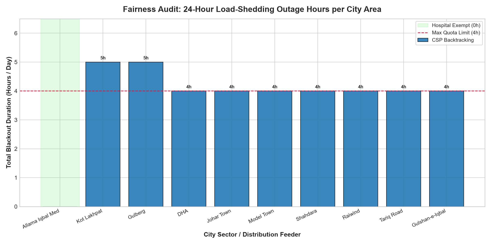
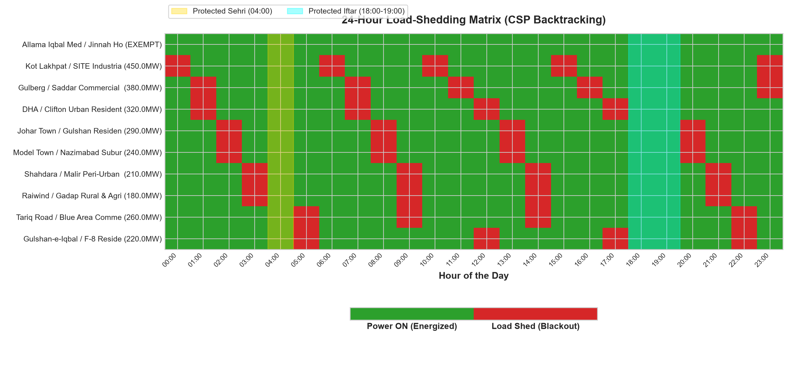
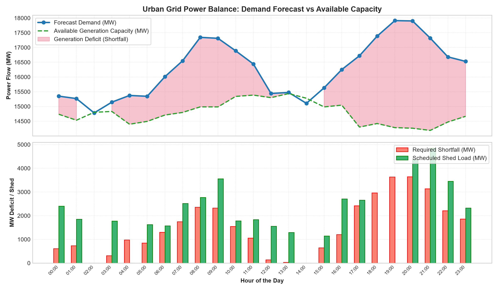

# ⚡ Electricity Demand Forecast & Fair Load-Shedding Scheduler

> **Project 24 | High Difficulty**  
> **Core AI Techniques**: Supervised Regression, Bayesian Networks, Markov Models, Constraint Satisfaction Problems (CSP), Hill Climbing & Local Search, Heuristic Search ($A^*$), Evolutionary Algorithms, Unsupervised Clustering, and Reinforcement Learning (Q-Learning).
> **Tools & Libraries**: Pure Python (zero external optimization/search libraries), NumPy, Pandas, Scikit-learn, Matplotlib, Plotly.

---

## 📌 1. Project Overview & Context

In developing nations such as **Pakistan** (served by distribution companies like LESCO, K-Electric, IESCO, and MEPCO), electricity grid operators face severe seasonal demand spikes—driven by extreme summer heatwaves and high air-conditioning loads—that exceed available generation capacity. 

When demand exceeds generation, distribution companies must enforce **load-shedding** (rolling blackouts). However, manual or naive load-shedding creates severe societal and economic disruption:
- Vital **emergency medical services and hospitals** suffer catastrophic power interruptions.
- Cultural observances such as **Iftar and Sehri meals during Ramadan** are plunged into darkness.
- Industrial zones experience unplanned shutdowns, damaging heavy machinery and economic productivity.
- Residential areas face deep inequity: some neighborhoods bear 8+ hours of daily blackouts while adjacent areas suffer none.

This project delivers a complete, mathematically grounded **Electricity Demand Forecasting & Fair Load-Shedding Scheduler**. It combines **next-day 24-hour hourly demand regression forecasting** with an automated **scheduling optimization engine** that covers the generation shortfall while guaranteeing hard constraints and maximizing equity (fairness) across city sectors.

The live scheduler also uses a discrete Bayesian Network and a first-order Markov chain to estimate hourly shortfall risk. The Markov chain predicts shortfall-state priors from transitions in simulated historical shortfalls; the Bayesian Network updates those priors using hour, temperature, demand, and simulated capacity-margin evidence. The expected shortfall is passed to the existing CSP, hill-climbing, and genetic schedulers; these models augment those algorithms rather than adding separate algorithm choices.

---

## 🏛️ 2. AI Lab Syllabus Mapping & Architecture

The retained AI lab tasks from the syllabus are implemented **from scratch in pure Python without bloated or high-level optimization/search libraries**, demonstrating foundational algorithmic mechanics:

| Lab Week / Task | AI Paradigm / Topic | Module | Real-World Grid Implementation & Role |
| :--- | :--- | :--- | :--- |
| **Task 1 (Weeks 1–2)** | **Types of Agents & Environments** | [`src/agent_environment.py`](src/agent_environment.py) | Formal **PEAS** specification; environment properties classification; implementation of **Simple Reflex**, **Model-Based**, **Goal-Based**, and **Utility-Based Fair Dispatch** agents. |
| **Task 2 (Week 3 / Lab 3)** | **Uninformed Searching Algorithms** | [`src/uninformed_search.py`](src/uninformed_search.py) | **Breadth-First Search (BFS)** (minimal feeder count), **Depth-First Search (DFS)**, and **Uniform Cost Search (UCS / Dijkstra)** (minimal socio-economic disruption cost). |
| **Task 3 (Week 4 / Lab 4)** | **Informed Searching Algorithms** | [`src/informed_search.py`](src/informed_search.py) | **Greedy Best-First Search** ($h(n)$ deficit distance) and **$A^*$ Search** ($f(n) = g(n) + h(n)$ with mathematically admissible unit-cost lower-bound heuristic). |
| **Task 4 (Week 5 / Lab 5)** | **Constraint Satisfaction Problems (CSP)** | [`src/csp_scheduler.py`](src/csp_scheduler.py) | 24-hour schedule formulation using **Backtracking Search**, **Minimum Remaining Values (MRV)** heuristic, **Degree heuristic**, **Least Constraining Value (LCV)**, and **Forward Checking**. |
| **Task 5 (Week 7 / Lab 6)** | **Local & Evolutionary Search** | [`src/local_evolutionary_search.py`](src/local_evolutionary_search.py) | **Steepest-Ascent Hill Climbing** (1-flip and 2-swap neighborhoods) and **Genetic Algorithm** (2-point crossover, bit-flip mutation, elitism). |
| **Probabilistic scheduling** | **Bayesian Network & Markov Model** | [`src/probabilistic_scheduler.py`](src/probabilistic_scheduler.py) | Discrete shortfall-state transition priors updated by Bayesian evidence; expected shortfall feeds the existing scheduler engines. |
| **Task 7 (Week 10 / Lab 9)** | **Supervised Learning** | [`src/models.py`](src/models.py) | Scikit-learn **Linear Regression** and **Random Forest Regressor** for next-day demand prediction. |
| **Task 8 (Week 12 / Lab 10)** | **Unsupervised Learning** | [`src/unsupervised_learning.py`](src/unsupervised_learning.py) | Pure NumPy **K-Means Clustering (Lloyd's Algorithm + K-Means++ init)** grouping city sectors into Critical, Heavy Industrial, Urban Commercial, and Flexible Agricultural archetypes. |
| **Lab 11 (Week 13)** | **Reinforcement Learning** | [`src/reinforcement_learning.py`](src/reinforcement_learning.py) | **Tabular Q-Learning Agent** with state $(h, \text{DeficitBucket}, \text{DisparityBucket})$, $\epsilon$-greedy exploration with decay, learning multi-sector load shedding policies. |

---

## 🏙️ 3. City Sector Feeders & Hard Constraints

The urban distribution network models 10 heterogeneous distribution zones ($2^{240}$ possible schedule combinations):

```text
City Distribution Grid (Total Base Load ~ 2,670 MW | 10 Sectors)
├── [F01_HOSP]   Allama Iqbal Medical / Jinnah Hospital Feeder (120 MW)  --> CRITICAL EXEMPT (0h Outage)
├── [F02_IND]    Kot Lakhpat / SITE Industrial Zone            (450 MW)  --> Max 4h / Disruption Cost 350
├── [F03_COMM_A] Gulberg / Saddar Commercial District          (380 MW)  --> Max 4h / Disruption Cost 250
├── [F04_RES_A]  DHA / Clifton Urban Residential Feeder        (320 MW)  --> Max 4h / Disruption Cost 150
├── [F05_RES_B]  Johar Town / Gulshan Residential Feeder       (290 MW)  --> Max 4h / Disruption Cost 140
├── [F06_SUB_A]  Model Town / Nazimabad Suburban Feeder        (240 MW)  --> Max 4h / Disruption Cost 120
├── [F07_SUB_B]  Shahdara / Malir Peri-Urban Feeder            (210 MW)  --> Max 4h / Disruption Cost 110
├── [F08_RUR]    Raiwind / Gadap Rural & Agricultural Feeder   (180 MW)  --> Max 5h / Disruption Cost 90
├── [F09_COMM_B] Tariq Road / Blue Area Commercial Hub         (260 MW)  --> Max 4h / Disruption Cost 230
└── [F10_RES_C]  Gulshan-e-Iqbal / F-8 Residential Feeder      (220 MW)  --> Max 4h / Disruption Cost 130
```

### 🔒 Operational Constraints Strictly Enforced:
1. **Hospital & Emergency Feeder Exemption (Hard Constraint)**:
   $$X_{\text{hospital}, h} = 0 \quad \forall h \in \{0, \dots, 23\}$$
   Hospitals receive uninterrupted power 24/7/365 under every algorithm.
2. **Ramadan Observance Protection (Hard Constraint)**:
   $$X_{a, h} = 0 \quad \forall a, \; h \in \{4, 18, 19\}$$
   Zero load-shedding is permitted during Sehri ($04:00$) and Iftar/Maghrib ($18:00–19:59$).
3. **Maximum Daily Outage Quota (Hard Constraint)**:
   $$\sum_{h=0}^{23} X_{a, h} \le \text{MaxDailyHours}_a \quad (\le 4\text{ hours/day for non-critical areas})$$
4. **Maximum Consecutive Outage (Hard Constraint)**:
   $$X_{a, h} + X_{a, h+1} + X_{a, h+2} \le 2 \quad \forall a, h$$
   No neighborhood may be disconnected for more than 2 consecutive hours.
5. **Shortfall Fulfillment (Grid Reliability Constraint)**:
   $$\sum_{a=1}^N X_{a, h} \cdot \text{Demand}_{a, h} \ge \text{Shortfall}_h - \epsilon$$
   Prevents grid collapse / frequency cascading trip.

---

## ⚖️ 4. Fairness Metrics & Multi-Algorithm Benchmark

Fairness is quantified using **Jain's Fairness Index**, Standard Deviation, and Gini Inequality on the non-exempt feeder outage distribution:
$$J(x_1, \dots, x_k) = \frac{\left(\sum_{i=1}^k x_i\right)^2}{k \cdot \sum_{i=1}^k x_i^2}$$
- **$J = 1.0$**: Absolute equity (every residential/commercial neighborhood receives identical outage hours).
- **$J \to 1/k$**: Extreme unfairness (one neighborhood absorbs all blackouts while others get zero).

### 📊 Benchmark Results on 24-Hour Horizon (35,736 MWh Deficit):

| Scheduling Algorithm | Jain's Fairness Index | Outage Std Dev ($\sigma$) | Max-Min Spread | Shortfall Covered | Hospital Shed | Ramadan Violations | Consecutive Violations | Fully Compliant |
| :--- | :---: | :---: | :---: | :---: | :---: | :---: | :---: | :---: |
| **CSP Backtracking (MRV + FC)** | **0.960** | **0.64 h** | **2 h** | **78.8%** | **0 h** | **0** | **0** | **Yes** |
| **Steepest-Ascent Hill Climbing** | **0.960** | **0.64 h** | **2 h** | **78.8%** | **0 h** | **0** | **0** | **Yes** |
| **Genetic Algorithm (Evolutionary)** | 0.913 | 1.81 h | 6 h | 78.8% | 0 h | 0 | 0 | Yes |
| **Tabular Q-Learning Agent** | 0.683 | 3.02 h | 8 h | 78.8% | 0 h | 0 | 2 | Partial |

### 📈 Diagnostic Visualizations

#### 1. Fairness Chart: Outage Hours per City Area


#### 2. 24-Hour Load-Shedding Matrix Heatmap


#### 3. Grid Power Balance: Demand vs Available Capacity vs Load Shed


---

## 🔮 5. Supervised Learning: Next-Day Hourly Demand Forecasting

Next-day hourly electricity demand is predicted using feature engineering that eliminates lookahead leakage:
- **Lags**: $t-1\text{h}, t-2\text{h}, t-24\text{h}, t-168\text{h}$ (1 week).
- **Rolling Windows**: 24h moving mean, standard deviation, min, max.
- **Cyclical Trigonometric Encodings**: $\sin(2\pi h / 24)$, $\cos(2\pi h / 24)$ for smooth 23:00 to 00:00 transition.
- **Weather Interactions**: Cooling degree days ($\max(0, T - 22^\circ\text{C})$) and heating degree days ($\max(0, 14^\circ\text{C} - T)$).

### 🏆 Model Comparison (Evaluated on Chronological Test Partition):

| Model | Implementation | MAE (MW) | RMSE (MW) | MAPE (%) | $R^2$ Score | Mean Bias Error |
| :--- | :--- | :---: | :---: | :---: | :---: | :---: |
| **Random Forest Regressor** | Scikit-Learn | **241.64** | **306.41** | **1.61%** | **0.9509** | -30.06 MW |

---

## 🚀 6. Installation & Quickstart

### Prerequisites
- Python 3.10+ (tested on Python 3.11, 3.12, 3.13, 3.14)
- Standard virtual environment

### 1. Set Up Environment
```bash
# Clone repository
git clone https://github.com/your-username/AI-Energy-Forecasting.git
cd AI-Energy-Forecasting

# Activate virtual environment
# Windows:
.\venv\Scripts\activate
# Linux / macOS:
source venv/bin/activate

# Install dependencies
pip install -r requirements.txt
```

### 2. Run the Complete AI Lab Syllabus Showcase Runner
Executes Tasks 1 through 8 + RL and prints step-by-step console outputs, metrics tables, and exports publication charts:
```bash
python -m src.lab_showcase
```

### 3. Launch the Modern FairShed Web GUI (HTML5, Tailwind & Chart.js)
Runs the custom modern high-tech web dashboard matching the FairShed design:
```bash
python gui/server.py
```
*(Automatically opens `http://localhost:8000` in your default browser, or double-click `gui/index.html` to open directly).*

### 4. Run the Full Automated Test Suite
Runs all unit and integration tests across data processing, search algorithms, CSP, optimization, and ML models:
```bash
pytest tests -v
```

---

## 📁 7. Repository Structure

```text
AI-Energy-Forecasting/
├── gui/                            # Modern FairShed Web GUI (HTML5, Tailwind, Chart.js)
│   ├── index.html                  # Main responsive single-page application
│   ├── styles.css                  # Custom glassmorphic styling, twilight skyline & animations
│   ├── app.js                      # Interactive Chart.js, SVG city map & scheduling logic
│   └── server.py                   # Zero-dependency local web server (http.server)
├── data/
│   ├── raw/energy_consumption.csv  # Raw hourly load & temperature dataset
│   └── processed/energy_features.csv # Engineered leak-free feature matrix
├── images/                         # Diagnostic figures & visual charts
├── models/                         # Serialized baseline, linear & RF models
├── reports/figures/                # Publication-grade Matplotlib output figures
├── src/
│   ├── __init__.py
│   ├── city_grid.py                # 10 City Feeder definitions & generation shortfall model
│   ├── agent_environment.py        # Task 1: PEAS & 4 Agent Architectures (Reflex, Model, Goal, Utility)
│   ├── uninformed_search.py        # Task 2: BFS, DFS, and Uniform Cost Search (from scratch)
│   ├── informed_search.py          # Task 3: Greedy Best-First and A* Search (from scratch)
│   ├── csp_scheduler.py            # Task 4: CSP Backtracking with MRV & Forward Checking
│   ├── local_evolutionary_search.py# Task 5: Steepest-Ascent Hill Climbing, Genetic Algo
│   ├── probabilistic_scheduler.py  # Markov shortfall transitions + Bayesian risk inference
│   ├── maintenance_dispatch.py      # UCS route selection and 3-team maintenance dispatch
│   ├── unsupervised_learning.py    # Task 8: Scratch K-Means Feeder Profiling (Lloyd's Algorithm)
│   ├── reinforcement_learning.py   # Lab 11: Tabular Q-Learning Load Dispatch Agent
│   ├── fairness_metrics.py         # Jain's Index, Gini Coefficient, Outage Spread & Auditing
│   ├── visualization.py            # Matplotlib visualizer for heatmaps, fairness, and power balance
│   ├── lab_showcase.py             # Master CLI runner executing all AI Lab syllabus tasks
│   ├── data_loader.py              # Ingestion & synthetic fallback data generator
│   ├── data_cleaner.py             # Deduplication, interpolation, missing hour imputation
│   ├── feature_engineering.py      # Cyclical trigonometric & lag engineering
│   ├── models.py                   # Chronological train/test split & scikit-learn models
│   ├── evaluate.py                 # Multi-metric evaluation utilities
│   └── pipeline.py                 # Full ML training pipeline
└── tests/                          # Automated Unit & Integration Tests
    ├── test_agents.py              # Tests for Task 1 Agent Architectures & PEAS
    ├── test_search_algorithms.py   # Tests for Tasks 2 & 3 (BFS, DFS, UCS, GBFS, A*)
    ├── test_csp_and_optimization.py# Tests for Tasks 4 & 5 (CSP, Hill Climbing, GA)
    ├── test_probabilistic_scheduler.py # Tests for Markov/Bayesian shortfall scheduling
    ├── test_maintenance_dispatch.py # Tests for UCS team assignment and planned-outage rejection
    ├── test_ml_and_filtering.py    # Tests for clustering, Q-Learning, and fairness
    ├── test_data_loader.py
    ├── test_data_cleaner.py
    ├── test_feature_engineering.py
    ├── test_models.py
    ├── test_evaluate.py
    └── test_pipeline_e2e.py
```

---

## 📜 License

This project is licensed under the [MIT License](LICENSE).
